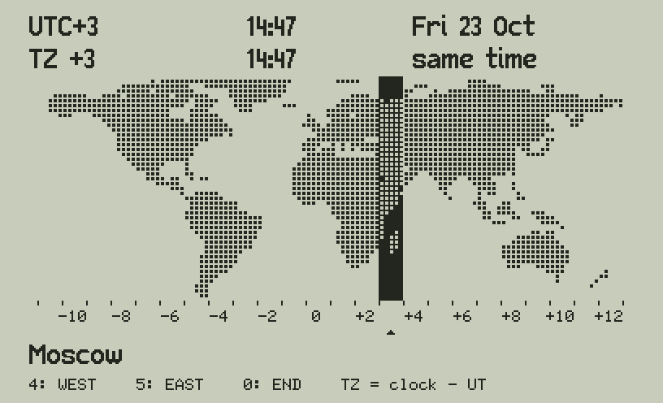

# Zones 47 — world time zones for the C47 / R47

`ZONE47` shows a dot map of the world on the SwissMicros C47 / R47 and steps through the **official time
zones** with the keys 4 and 5 (or 6), highlighting the 15° column of each one — in the spirit of the time-zone
page of a Garmin watch, without highlighting countries.

## What it shows

- **The map**: 120 × 45 dots, 3° a dot, 81°N to 54°S, in 24 columns of 15° (UTC−11 at the left, UTC±12 at
  the right: 172.5°E to 172.5°W). Zone numbers and ticks under the map.
- **The stops**: one per official standard offset of the IANA tz database (tzdata 2026e): 37 from −11 to +14,
  including +5:30, +5:45, +8:45, +12:45, +13 and +14, plus **−12 "at sea"** (the nautical zone, no one lives
  there). The highlighted column is the offset's own for whole hours −12…+12; the others take the column of
  their city's longitude.
- **Line 1**: the offset in force now, the local time and date there (weekday, day, month), **daylight
  saving included**.
- **Line 2**: your clock (`TZ`), its time, and the difference.
- **Cities**: every country of the offset (311 cities in all, from tzdata's `zone.tab`: one per country and
  DST rule, so the US has New York, Chicago... and Colombia has Bogota, plus Medellin). Keys 8 / 2 step
  through them; each city has its own daylight saving, so the time shown is that city's.
- **Under the map**: the city, its country, its place in the list and its DST now, e.g.
  `Medellin CO  4/16`, `New York US  1/16  summer +1 h`, `Sydney AU  1/7  winter, DST +1 h`,
  `Casablanca MA  8/26  DST varies` (its changes follow Ramadan: no fixed rule, standard time shown).
- A triangle marks the column of your own zone (the stop nearest to `TZ` now). The time updates every
  minute, also across a DST change.

## Daylight saving, worked out on the calculator

Each stop's city has its DST rule from the IANA tz database, found by `tools/make_zones.py` from the real
transitions of 2026-2035 and checked to follow one rule: the n-th (or last) weekday of a month at an hour of
standard time (the hour may run past midnight: Chile changes on the Saturday at 24:00, Israel on the Friday
before the last Sunday). 17 rules cover all the cities with DST. ZONE47 computes the start and end of the
current year from the date and adds the DST when it is on, northern or southern hemisphere.

## Keys

| Key | |
|---|---|
| 4 | the stop west (a smaller offset) |
| 5 | the stop east (6 works too) |
| 8 / 2 | the city before / after in the stop |
| 0 | the end: the screen cleared, your stack and LASTx as they were |

At the ends it goes around: east of +14 is −12, west of −12 is +14.

## TZ: the offset of your clock

The calculator's clock has no time zone, so ZONE47 reads the global variable **TZ** = clock − UT in hours,
the same variable as MOON47 in [Almanac 47](https://github.com/valdesvj/almanac47):

    3 STO "TZ"      clock on UT+3
    -5.5 STO "TZ"   clock on UT−5:30
    0 STO "TZ"      clock on UT

`TZ` is what your clock shows minus UT, **summer time included** (Madrid in July: 2). If `TZ` is not there
(or is 0), ZONE47 asks for it at the start (`TZ=CLOCK-UT h, R/S`): key the hours and R/S, or just R/S to keep
0 (clock on UT). Change it when you change the calculator's clock (at sea, when the ship's time changes, or
at a DST change).

## Updating the time zones

The stops come from the computer's tz database (on Linux `/usr/share/zoneinfo`, the package `tzdata`):

    python3 tools/make_zones.py      # python/zones.py from zone1970.tab, prints the stops and the tzdata version
    python3 tools/build_zone47.py    # programs/ and build/ZONE47.txt with the new stops
    python3 tests/test_zone47.py     # every stop and every DST change checked against Python's zoneinfo
    python3 tools/make_gif.py        # docs/ZONE47_tour.gif

## Build and files

| | |
|---|---|
| `programs_rem/ZONE47.txt` | the commented source (STRUCT, named labels) — edit this one |
| `programs/ZONE47.txt`, `build/ZONE47.txt` | the calculator program (to convert with rejig) |
| `listings/` | numbered steps with comments, the local labels |
| `python/worldmap.py` | the dot map (`tools/make_map.py`, land/sea from the GLOBE 1 km data, NOAA) |
| `python/zones.py` | the stops and their DST rules (`tools/make_zones.py`, from tzdata) |
| `python/c47sim.py`, `stdfont.py`, `tinyfont.py` | the C47 simulator and fonts, from Almanac 47 |
| `python/zone47sim.py` | runs ZONE47 in the simulator, writes `docs/*.png` |
| `tests/test_zone47.py` | the tests |

Size: 2 012 steps, about 12 KB; 7 IF and 7 DO, within the original DM42's limit of 10 each, so it should also
run on a DM42 with the C47 firmware (not tried; Almanac 47's DM42 builds reach 13.5 KB).
Written with the C47 STRUCT commands (IF / ELSE / ENDIF, DO / WHILE / ENDDO).
Calculators: C47 / R47 with STRUCT, ATEXT and GRFNT (firmware 00.109.05.00a0.ALPHA or later, as Elements 47).
Not yet run on a real C47.

## Credits and licence

Victor Valdes, GNU GPL v3.0 or later (`LICENSE`, the same as Almanac 47; `NOTICE`). Written with the help of
AI, used responsibly: see `AI_ASSISTANCE.md`. Not an official time source.
Time zones: the IANA tz database (https://www.iana.org/time-zones), public domain. Map: global-land-mask
(GLOBE, NOAA). Fonts: the C43/C47 firmware. SwissMicros, C47, R47 and DM42 are trademarks of their owners.
